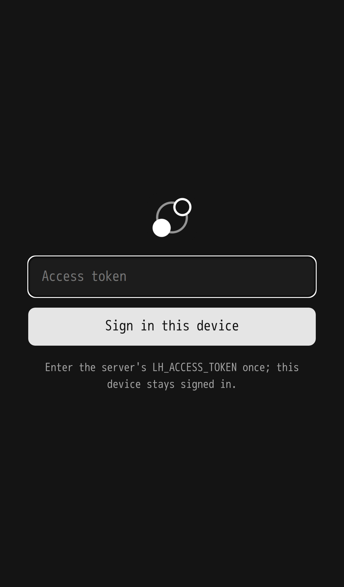
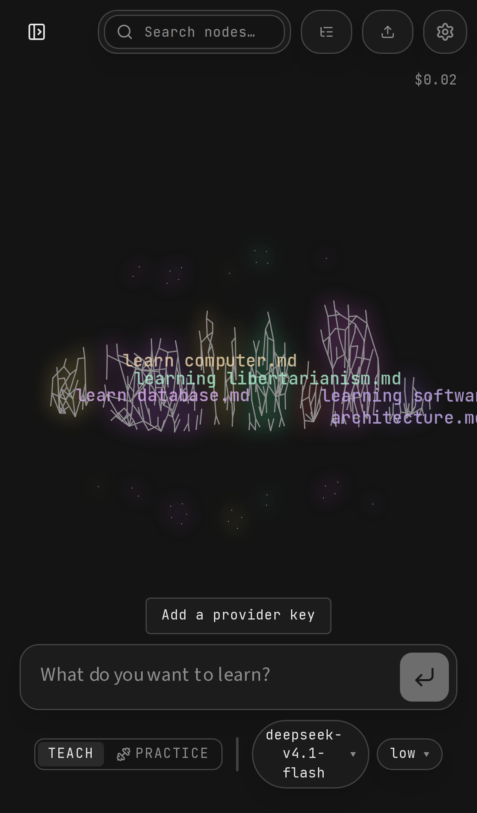
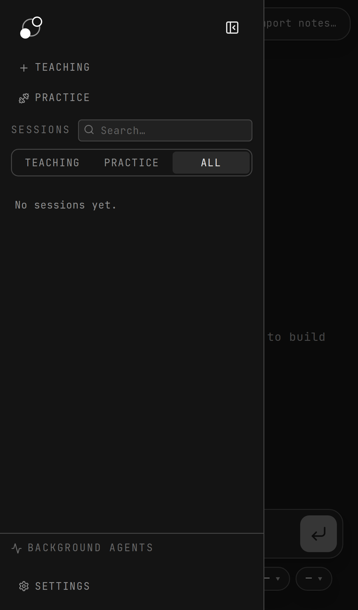
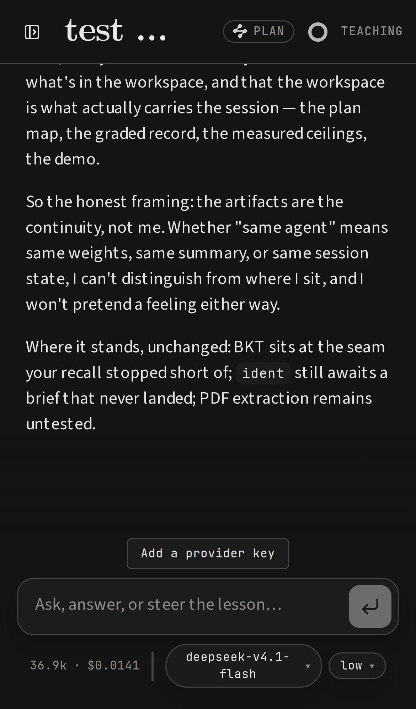
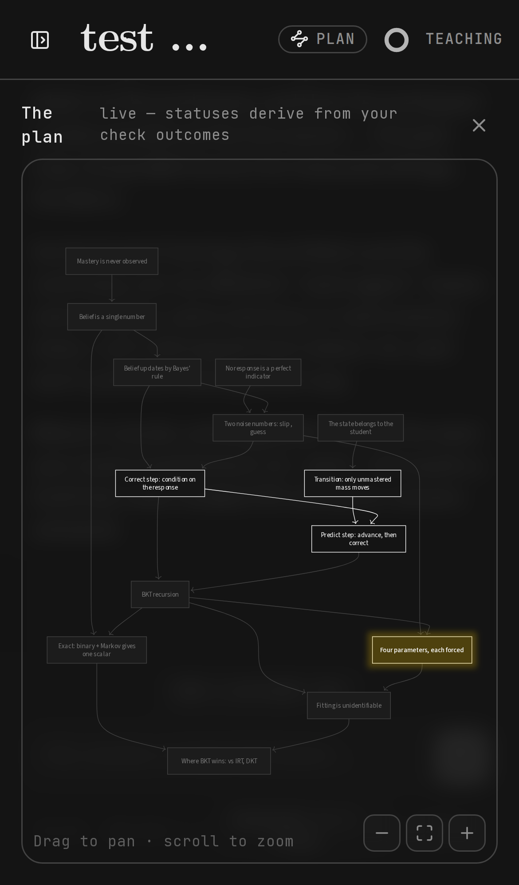
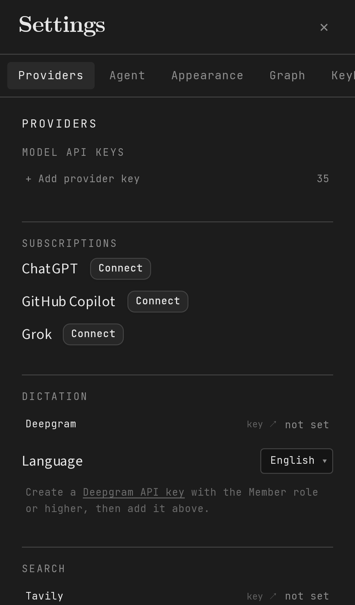

# Registro de contribución: LearnHarness autoalojado + PWA móvil

> Bitácora personal de la contribución (en español). No forma parte del PR upstream; la documentación técnica para el proyecto está en [`docs/self-hosting.md`](../self-hosting.md).

- **Proyecto:** [amosblomqvist/learnharness](https://github.com/amosblomqvist/learnharness), un harness de agentes de IA para aprender (AGPL-3.0)
- **Rama:** `feat/self-host-pwa`
- **Fecha:** 2026-10-28
- **Objetivo:** usar LearnHarness desde el teléfono, con todo corriendo en mi VPS, sin depender de la app de escritorio.

## El problema

LearnHarness es una app de escritorio (Electron + Next.js). Un agente "profesor" mide lo que sabes, planea una ruta de aprendizaje como grafo de dependencias, enseña paso a paso y va acumulando un grafo de conocimiento entre sesiones. Pero solo vivía en el escritorio:

1. **Sin acceso remoto seguro.** El servidor solo escucha en `127.0.0.1`. En modo navegador **no tiene ninguna autenticación**, así que exponerlo tal cual dejaría tus API keys a disposición de cualquiera que llegue al puerto.
2. **No se podía instalar en el teléfono.** No había manifest ni service worker.
3. **La interfaz no estaba pensada para el teléfono.** En un iPhone, el sidebar ocupaba ~75% del ancho y el contenido quedaba aplastado en una franja; el compositor mostraba una letra por línea.

## Lo que encontré al analizar el código (y por qué era viable)

- La interfaz **ya es web**: Electron solo arranca un servidor Next.js y abre una ventana que apunta a él.
- Los turnos del agente **corren en el servidor, no en el navegador**. Existe un stream SSE reanudable por sesión (`GET /api/chats/[id]/stream`) que reproduce el turno en curso desde el inicio. Retomar una lección desde otro dispositivo ya funcionaba por diseño.
- La arquitectura es hexagonal y tiene reglas de capas verificadas por lint. Eso permitió agregar la función sin tocar el núcleo de dominio.

Conclusión: no hacía falta una app nueva. Bastaba con **una puerta de acceso, una capa PWA y un pase responsive**.

## Decisiones de diseño

| Decisión | Por qué |
|---|---|
| **Tailscale** como red | Cero puertos abiertos, HTTPS automático (`tailscale serve`), sin dominio ni certificados. Lo más simple que sigue siendo seguro para un solo usuario. |
| **Token de acceso opcional** (`LH_ACCESS_TOKEN`) + cookie | Una segunda cerradura por si el puerto se expone por error. Si la variable no está definida, el comportamiento es idéntico al original y el modo escritorio no cambia. |
| La cookie guarda un **HMAC del token**, no el token | Si alguien la lee, no obtiene el secreto. Rotar el token cierra la sesión en todos los dispositivos. |
| Token corto (<16) **falla cerrado** | Mejor bloquear por un error de configuración que dejar la puerta abierta. |
| `/access` como *route handler* con HTML plano | Se renderiza fuera del shell de la app, sin sidebar haciendo peticiones antes de iniciar sesión, y no necesita JS. |
| Redirecciones con `X-Forwarded-Host/Proto` | Detrás de `tailscale serve` el servidor ve `127.0.0.1`. Sin esto, el teléfono habría sido redirigido a su propio localhost. Bug encontrado en pruebas y corregido. |
| Service worker **mínimo** | Solo cachea assets inmutables (`/_next/static`). Nunca toca `/api/*` ni datos de aprendizaje. Si no hay servidor, muestra una página clara en lugar del error del navegador. |
| Responsive **solo con breakpoints** (`max-sm`, `<768px`) | No cambia nada en escritorio. El sidebar pasa a ser un drawer superpuesto solo en teléfonos. |

## Qué se construyó

**Backend / seguridad**
- `src/server/remote-access.ts`: verificación del token (comparación en tiempo constante), cookie HMAC y validación del destino post-login (evita *open redirect*).
- `proxy.ts`: dos puertas independientes. La del escritorio queda intacta; el gate de self-host protege páginas y API (redirige a `/access` o responde 401) y acepta `Authorization: Bearer` para scripts.
- `app/access/route.ts`: pantalla de inicio de sesión por dispositivo, con cookie `HttpOnly`, `SameSite=Lax`, `Secure` y duración de 1 año.

**PWA**
- `app/manifest.ts`, iconos generados desde el SVG original (`scripts/make-icons.mjs`, incluido el icono *maskable*), metadatos para iOS.
- `public/sw.js` + `public/offline.html` + registro del service worker solo en producción y fuera de Electron.

**Interfaz móvil**
- Sidebar → drawer superpuesto con fondo oscuro: cerrado por defecto, se cierra al navegar y no altera la preferencia guardada en escritorio.
- Barra del grafo: los botones quedan solo con icono y se corrigió un desbordamiento que tapaba el botón de menú.
- Settings: pantalla completa con pestañas horizontales.

**Despliegue en un comando**
- `deploy/self-host/setup.sh`: compila, genera un token aleatorio, instala el servicio systemd ligado a loopback y lo publica con `tailscale serve`. Es idempotente y sirve también para actualizar.
- Guía completa: [`docs/self-hosting.md`](../self-hosting.md).

## Calidad

- **7 tests nuevos** (`tests/remote-access.test.ts`): gate apagado/encendido, cookie vs. token crudo, token débil, *open redirect*, redirección con headers reenviados y flujo completo de `/access`.
- Suite completa del proyecto: **2524 tests**. El único test que falló durante el desarrollo, por la ausencia de `matchMedia` en el DOM de pruebas, llevó a un guard defensivo.
- `tsc`, ESLint (incluidas las reglas de capas de la arquitectura) y `next build` en verde.
- Verificación visual end-to-end con Playwright en viewport de iPhone 13: login, drawer, grafo, sesión, panel del plan y settings. El service worker queda registrado y no hay errores de página.

## Capturas (iPhone 13)

| Inicio de sesión | Grafo de conocimiento | Drawer de sesiones |
|---|---|---|
|  |  |  |

| Lección | Plan (ruta de aprendizaje) | Settings |
|---|---|---|
|  |  |  |

## Aprendizajes

- **Leer la arquitectura antes de escribir código.** El hallazgo clave (los turnos corren en el servidor y el stream es reanudable) convirtió "sincronizar sesiones entre dispositivos" en algo que ya existía.
- **Los proxies mienten sobre la URL.** Detrás de un reverse proxy, `request.url` no es lo que ve el usuario. `X-Forwarded-*` importa.
- **Un cambio aditivo es más fácil de aceptar upstream.** Todo es opt-in: sin `LH_ACCESS_TOKEN` y en escritorio, el comportamiento es el mismo de antes.

## Próximos pasos

- Notificaciones push cuando el agente termina un turno o una investigación en segundo plano.
- Un pase de UX más fino en el dock de preguntas y el chain table en pantallas pequeñas.
- Proponer el PR upstream (sin esta bitácora), con las decisiones abiertas a la revisión del mantenedor.

---

## Borrador para LinkedIn

> **Llevé un tutor de IA de escritorio a mi teléfono, sin escribir una app nueva.**
>
> Llevo un tiempo usando LearnHarness, un proyecto open source donde agentes de IA te enseñan: miden lo que sabes, trazan una ruta de aprendizaje como grafo y construyen un grafo de conocimiento que crece contigo. Mi problema: solo vivía en el escritorio, y yo quería estudiar desde el teléfono.
>
> Antes de escribir una línea, leí la arquitectura. El agente ya corría en el servidor y las lecciones ya eran reanudables. No faltaba una app móvil; faltaban tres piezas:
>
> 🔐 **Acceso seguro**: un gate opcional por token (cookie HMAC, comparación en tiempo constante, falla cerrado) detrás de Tailscale. Cero puertos abiertos.
> 📱 **PWA instalable**: manifest, iconos y un service worker que deliberadamente nunca cachea datos de aprendizaje.
> 🧭 **Interfaz móvil**: sidebar como drawer, toolbar compacta y settings a pantalla completa, todo con breakpoints y sin cambios en escritorio.
>
> Más un script que deja todo corriendo en un VPS en ~10 minutos.
>
> El bug más interesante: detrás de `tailscale serve` el servidor cree que vive en `127.0.0.1`, así que el login redirigía al teléfono… a su propio localhost. Los headers `X-Forwarded-*` lo resolvieron.
>
> Resultado: 7 tests nuevos, los 2500+ existentes en verde y verificación end-to-end en un iPhone simulado. Ahora empiezo una lección en la laptop y la termino en el metro.
>
> Open source (AGPL-3.0) 👉 [enlace al repo/PR]
>
> #OpenSource #AI #NextJS #PWA #Tailscale #SelfHosting #EdTech
